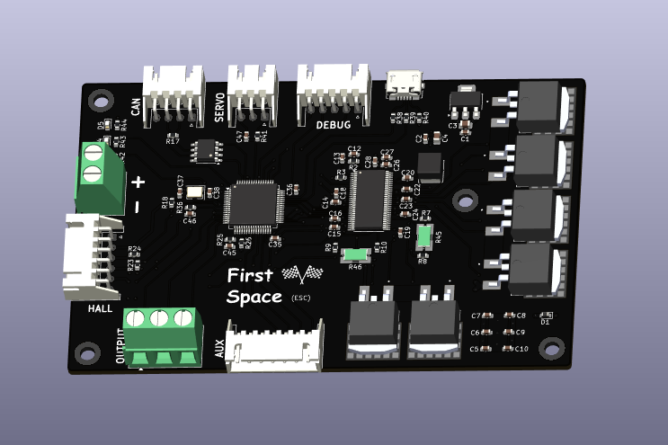
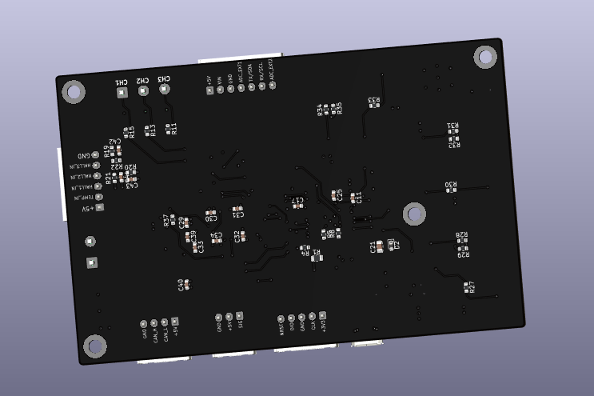
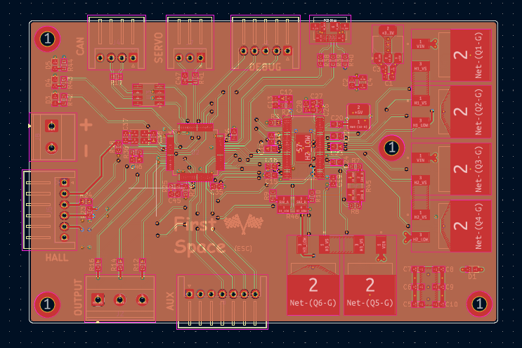

# Firstspace (Electronics)

Firstspace is an electric GoKart developed by the BigBrain group.

## Overview

The electric GoKart consists of all custom electronics which includes an electronic speec controller (ESC), battery management system (BMS), and a control system based on an STM32-based micro-controller chip.

See [Schematics](Electronics/ESC/ESC.pdf)

## Routing

This is a 6 layer pcb.

## Features

### ESC Core

- STM32F405 Cortex-M4 MCU
- Upto 168 MHz CPU clock
- Hall effect auxiliary connectors
- Upto 3 ESC outputs
- Auxiliary communications and servo connectors

## Authors 👥

Shaurya (Electronics)  
Contact: [Email](shauryatamang.dev@gmail.com)

Krish (CAD)
View: [Github](https://github.com/unknowngamer69/)
